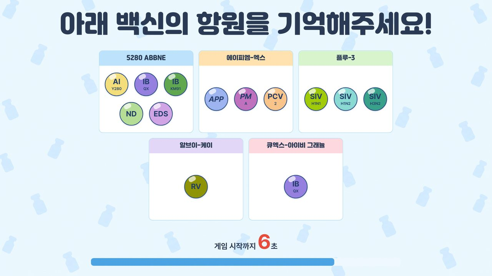
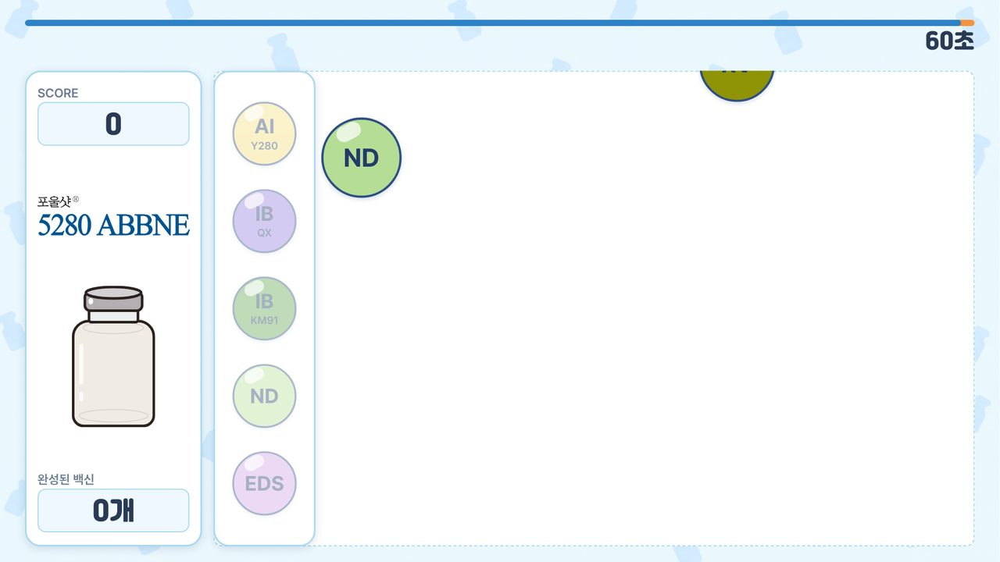
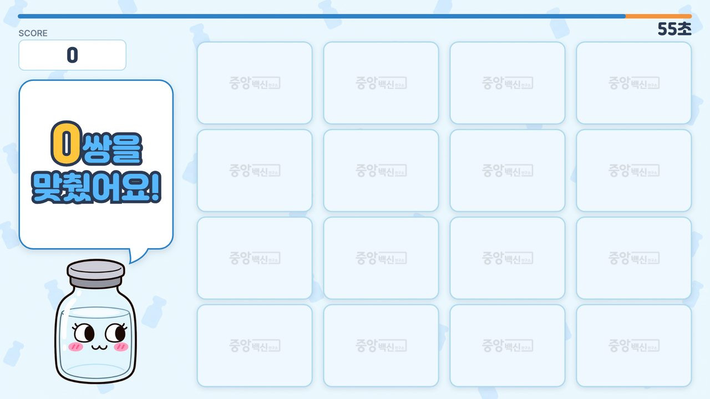
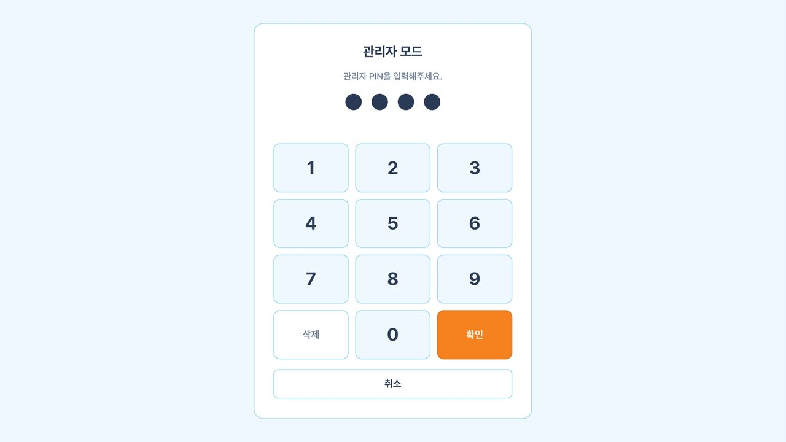
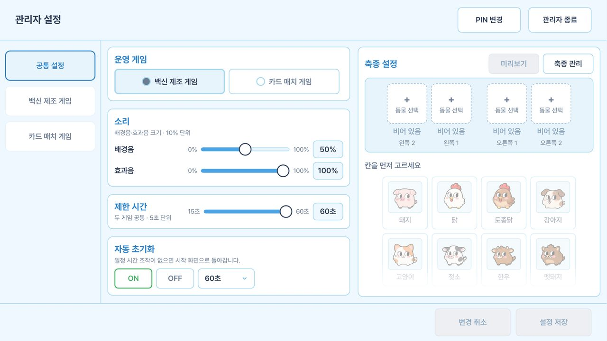
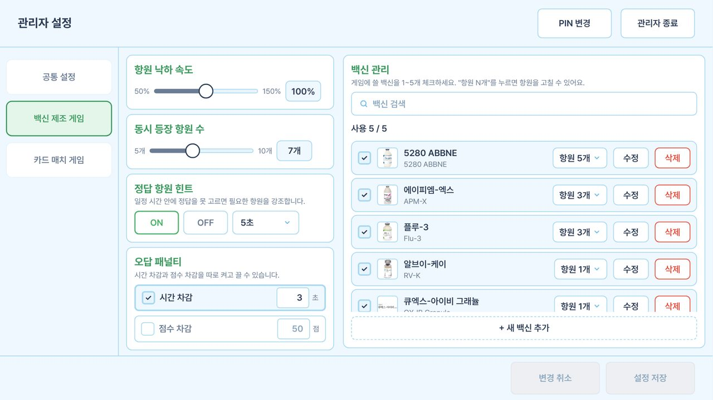
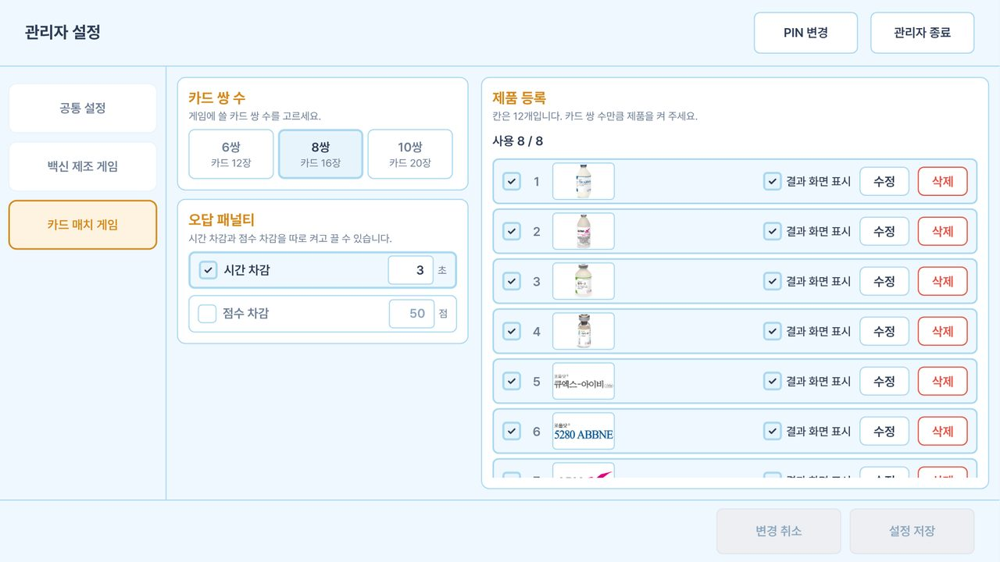
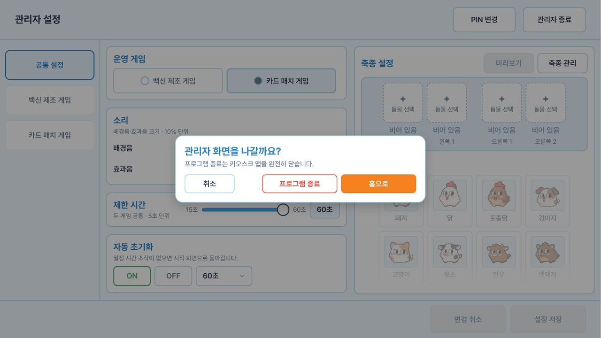

# CAVAC 키오스크 게임

CAVAC(중앙백신연구소) 전시 부스에서 관람객이 터치로 즐기는 **오프라인 키오스크 게임**입니다.
Windows exe 로 배포하며, 인터넷 없이 전체화면으로 동작합니다.

- **백신 제조 게임**: 백신에 들어가는 항원을 기억했다가, 떨어지는 항원 중 필요한 것만 골라 백신을 완성합니다
- **카드 매치 게임**: 제품 사진 카드의 위치를 기억했다가 같은 카드끼리 짝을 맞춥니다
- **관리자 화면**: 운영 게임, 제한 시간, 소리, 축종, 백신, 카드 제품을 현장에서 바꿉니다
- 한국어와 영어를 지원하고, 점수는 저장하지 않습니다

| 백신 제조 게임 | 카드 매치 게임 |
| --- | --- |
|  |  |
|  |  |
|  |  |

## 목차

1. [개발 모드로 실행하기](#개발-모드로-실행하기)
2. [배포용 exe 만들기](#배포용-exe-만들기)
3. [키오스크에서 exe 로 운영하기](#키오스크에서-exe-로-운영하기)
4. [데이터 관리](#데이터-관리)
5. [개발 참고](#개발-참고)

## 개발 모드로 실행하기

### 준비

Bun 버전은 `mise.toml` 에 고정되어 있습니다. [mise](https://mise.jdx.dev) 를 쓰면 자동으로 맞춰집니다.

```bash
bun install
git config commit.template .gitmessage
cp .env.example .env.local
```

`.env.local` 의 `MASTER_PIN_HASH` 에는 마스터 PIN 해시를 넣습니다. PIN 원문은 저장소 어디에도 남기지 않습니다.

```bash
bun electron/scripts/hash-pin.ts
# PIN 을 입력하면 MASTER_PIN_HASH=scrypt:... 한 줄이 나옵니다. 그대로 .env.local 에 붙여 넣습니다
```

### 실행

```bash
bun run dev
```

Electron 창이 뜨고, 코드를 고치면 바로 반영됩니다. 개발 모드에서는 창 모드로 뜨고 개발자 도구(`Cmd + Option + I`)를 쓸 수 있습니다.

- `develop` 을 받은 뒤 `Failed to resolve import` 오류가 나면 새 패키지가 추가된 것이니 `bun install` 을 다시 실행합니다
- 브라우저에서 화면만 볼 때는 dev 서버 주소를 브라우저로 엽니다. Electron 이 없으면 목데이터(`src/data/mock`)로 동작합니다
  - `.env.local` 에 `VITE_MOCK_SCENARIO=empty` 를 넣으면 첫 실행 상태로 볼 수 있습니다

### 개발 모드의 데이터 위치

개발 모드에서 저장한 설정과 사진은 아래 폴더에 쌓입니다. 구조는 [데이터 관리](#데이터-관리)와 같습니다.

| OS | 위치 |
| --- | --- |
| macOS | `~/Library/Application Support/cavac-kiosk-game/` |
| Windows | `%APPDATA%\cavac-kiosk-game\` |

미리 만든 데이터로 확인하려면 앱을 끈 상태에서 `cavac-data` 안의 `data`, `images` 폴더를 이 위치에 복사합니다.

```bash
# macOS 예시. 기존 데이터를 먼저 백업합니다
mv ~/Library/Application\ Support/cavac-kiosk-game ~/Desktop/cavac-dev-backup
mkdir -p ~/Library/Application\ Support/cavac-kiosk-game
cp -R <미리 만든 데이터>/cavac-data/* ~/Library/Application\ Support/cavac-kiosk-game/
bun run dev
```

## 배포용 exe 만들기

```bash
bun run dist
```

타입 검사와 배포 모드 빌드를 거쳐 `release/` 에 두 가지 exe 가 나옵니다.

| 파일 | 용도 |
| --- | --- |
| `CAVAC Kiosk Portable 0.1.0.exe` | **포터블.** 설치 없이 실행하고, 설정과 사진을 exe 옆 `cavac-data/` 에 저장합니다. USB 로 옮기기 좋습니다 |
| `CAVAC Kiosk Setup 0.1.0.exe` | 설치형. 설정과 사진을 PC 의 `%APPDATA%\cavac-kiosk-game\` 에 저장합니다 |

- `.env.local` 에 `MASTER_PIN_HASH` 가 없거나 모양이 틀리면 빌드가 멈춥니다. 배포 빌드에는 마스터 PIN 이 꼭 들어가야 하기 때문입니다
- Windows PC 에서 빌드하는 것을 권장합니다. macOS, Linux 에서 Windows exe 를 만들려면 Wine 이 필요할 수 있습니다
- 앱 아이콘(`resources/icon.ico`)이 없으면 Electron 기본 아이콘으로 빌드됩니다

## 키오스크에서 exe 로 운영하기

### 1. 폴더 그대로 옮기기

포터블 exe 와 데이터 폴더를 한 폴더에 두고, 폴더째 USB 나 키오스크 PC 에 복사합니다.

```
CAVAC 키오스크/
├─ CAVAC Kiosk Portable 0.1.0.exe
└─ cavac-data/          설정과 사진. 없으면 처음 실행할 때 만들어집니다
   ├─ data/
   └─ images/
```

- exe 와 `cavac-data/` 는 **항상 함께** 옮깁니다. 그래야 관리자 화면에서 설정한 내용이 그대로 따라갑니다
- 운영 중에는 USB 를 빼지 않습니다. 불안하면 폴더를 키오스크 PC 에 복사해서 실행합니다

### 2. 실행

exe 를 더블클릭합니다. 실행할 때마다 임시 폴더에 풀고 뜨므로 첫 화면까지 몇 초 걸립니다.

- "Windows의 PC 보호" 창이 뜨면 **추가 정보 → 실행** 을 누릅니다 (코드 서명을 하지 않아 뜨는 경고입니다)
- 배포본은 전체화면 키오스크 모드로 뜹니다

### 3. 관리자 화면

화면 **왼쪽 위 모서리를 1.5초 누르고 있으면** PIN 입력 화면이 열립니다.

| PIN 입력 | 관리자 설정 |
| --- | --- |
|  |  |

- 처음 PIN 은 **`0000`** 입니다. 들어가서 헤더의 **PIN 변경** 으로 바로 바꿉니다
- PIN 을 잊었을 때는 마스터 PIN 으로 들어가 다시 정합니다. 마스터 PIN 은 빌드할 때 넣은 값이며 담당자에게 따로 받습니다
- 바꾼 값은 **설정 저장** 을 눌러야 파일에 반영됩니다

| 탭 | 하는 일 |
| --- | --- |
| 공통 설정 | 운영 게임, 소리 크기, 제한 시간, 자동 초기화, 메인 화면 동물과 축종 관리 |
| 백신 제조 게임 | 낙하 속도, 동시 등장 항원 수, 힌트, 패널티, 백신 목록(최대 5개 사용)과 항원 구성 |
| 카드 매치 게임 | 카드 쌍 수(6·8·10쌍), 패널티, 제품 사진 등록(최대 12칸) |

| 백신 설정 | 카드 설정 |
| --- | --- |
|  |  |

### 4. 종료

관리자 화면에서 **관리자 종료** 를 누르면 홈으로 돌아갈지, 프로그램을 끌지 고를 수 있습니다.
**프로그램 종료** 는 저장 중인 설정을 모두 마친 뒤 앱을 닫습니다.



## 데이터 관리

### 저장 위치

| 실행 방식 | 위치 |
| --- | --- |
| 포터블 exe | exe 옆 `cavac-data/` |
| 설치형 exe | `%APPDATA%\cavac-kiosk-game\` |
| 개발 모드 | macOS `~/Library/Application Support/cavac-kiosk-game/`, Windows `%APPDATA%\cavac-kiosk-game\` |

### 폴더 구조

```
data/
├─ common.json             공통 설정, 축종, 메인 화면 동물, 소리 크기
├─ vaccine-game.json       백신 제조 게임 설정, 백신, 항원
├─ card-game.json          카드 매치 게임 설정, 제품 칸
├─ pin.json                관리자 PIN 해시 (원문 없음)
├─ *.json.bak              바로 전 저장본. 원본이 깨지면 이 파일로 복구합니다
├─ *.json.corrupt-<시각>   읽지 못한 원본. 지우지 않고 남겨 둡니다
└─ default-species-seeded  기본 축종을 등록했다는 표시
images/
├─ species/                축종 캐릭터
├─ vaccine-bottle/         백신 병 (국문/영문)
├─ vaccine-logo/           백신 로고 (국문/영문)
└─ product/                카드 제품 사진 (국문/영문)
```

- 이미지는 관리자 화면에서 등록하면 `images/<종류>/<uuid>.png` 로 복사되고, 설정 파일에는 이 경로가 저장됩니다
- 설정에서 더 이상 쓰지 않는 이미지는 저장할 때와 앱을 켤 때 자동으로 지웁니다
- 설정 파일은 임시 파일에 쓴 뒤 이름을 바꾸는 방식으로 저장해서, 전원이 갑자기 꺼져도 깨지지 않습니다

### 첫 실행

`cavac-data/` 가 비어 있으면 처음 실행할 때 아래 상태로 시작합니다.

- 기본 축종 19종을 앱에 포함된 캐릭터 이미지로 등록합니다 (`resources/default-species`)
- 관리자 PIN 은 `0000` 입니다
- 백신과 카드 제품은 비어 있어 관리자 화면에서 등록해야 게임을 시작할 수 있습니다

### 미리 만든 데이터 넣기

전시 전에 다른 PC 에서 설정을 마친 `cavac-data/` 를 통째로 복사해 쓰면 됩니다.
일부 파일만 지워서 처음 상태로 되돌리지 마세요. 생각과 다르게 동작합니다.

- `pin.json` 만 지우면 `pin.json.bak` 의 예전 PIN 을 그대로 씁니다. `0000` 은 두 파일이 모두 없을 때만 받습니다
- `common.json` 만 지우면 `common.json.bak` 으로 복구됩니다. `.bak` 까지 지워도 `default-species-seeded` 가 남아 있으면 기본 축종을 다시 넣지 않아 축종이 비게 됩니다

처음 상태가 필요하면 아래 표처럼 `cavac-data/` 를 통째로 지웁니다.

### 백업과 초기화

| 하고 싶은 일 | 방법 |
| --- | --- |
| 지금 설정 백업 | 앱을 끄고 `cavac-data/` 폴더를 통째로 복사합니다 |
| 백업으로 되돌리기 | 앱을 끄고 `cavac-data/` 를 백업본으로 바꿉니다 |
| 완전히 처음 상태로 | 앱을 끄고 `cavac-data/` 를 지웁니다 |
| 깨진 설정 살펴보기 | `*.json.corrupt-<시각>` 을 메모장으로 엽니다. 앱은 `.bak` 이나 기본값으로 이미 복구한 상태입니다 |

설정 파일을 손으로 고치면 검사에 걸려 기본값으로 복구될 수 있으니, 값은 관리자 화면에서 바꾸는 것을 권장합니다.

## 개발 참고

### 기술 스택

| 영역 | 도구 |
| --- | --- |
| 개발 도구, 패키지 | Bun 1.4.2 |
| 언어, 빌드 | TypeScript, Vite |
| UI | React, Tailwind, cva, clsx, tailwind-merge |
| 상태, 검증 | Zustand, Zod |
| 애니메이션 | Motion |
| 다국어 | i18next, react-i18next |
| 포맷, 린트 | Biome |
| 테스트 | bun test, React Testing Library |
| 앱 런타임, 배포 | Electron, electron-builder |

### 명령어

| 명령 | 설명 |
| --- | --- |
| `bun run dev` | 개발 서버 + Electron 실행 |
| `bun run build` | 타입 검사 후 빌드 |
| `bun run preview` | 빌드 결과 미리보기 |
| `bun run dist` | Windows exe 패키징 (설치형, 포터블) |
| `bun run check` | Biome 검사 (PR 필수 통과) |
| `bun run check:fix` | Biome 자동 수정 |
| `bun run typecheck` | 타입 검사만 실행 |
| `bun test` | 테스트 실행 |
| `bun run clean` | 빌드 결과물과 node_modules 삭제 |
| `bun run clean:build` | 빌드 결과물만 삭제 |

### 폴더 구조

```
.github/               이슈, PR 템플릿과 CI 워크플로
docs/images/           README 화면 이미지
electron/
  main/                앱 실행, 창 생성, 설정 저장, 이미지, PIN, IPC (Node.js 영역)
  preload/             React 에 노출하는 API 계약
  scripts/             마스터 PIN 해시 생성
resources/             패키징용 리소스 (기본 축종 이미지, icon.ico)
src/
  pages/               화면 단위 (home, vaccine, card, admin)
  components/          재사용 UI (common, vaccine, card, admin)
  features/
    vaccine-game/      백신 제조 게임 로직 (hooks, utils)
    card-game/         카드 매치 게임 로직 (hooks, utils)
    admin/             관리자 로직 (modals, validation, utils)
  layout/              전역 레이아웃
  store/               Zustand 전역 상태
  hooks/               공통 커스텀 훅
  types/               공통 타입
  data/                데이터 스키마, 기본값, 저장 규칙, 목데이터, Platform 연결
  styles/              전역 스타일, 디자인 토큰
  utils/               공용 함수
  assets/              이미지, 사운드, 폰트
```

### 규칙

- 컨벤션은 Notion 의 **Git Convention** 문서를 따릅니다
- AI 코딩 도구 사용 시 [AGENTS.md](./AGENTS.md) 를 참고합니다
- 담당 영역은 [TEAM_OWNERSHIP.md](./TEAM_OWNERSHIP.md) 를 따릅니다
- 패키지 매니저는 bun 하나만 사용합니다
- 커밋 메시지는 자유이고 형식은 권장 사항입니다. PR 제목만 `#<이슈번호> <타입>(<범위>): <제목>` 형식을 지킵니다
